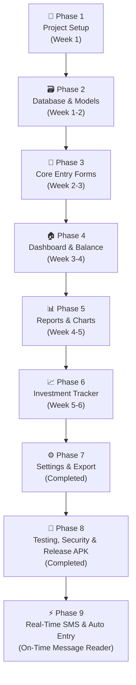

# 💰 Personal Finance Manager — Mobile App Full Roadmap
### Excel Logic → Fully Offline Flutter App

> [!IMPORTANT]
> App **100% Offline** रहेगा — SQLite local database, कोई server नहीं, कोई internet नहीं।

---

## 📊 Excel से समझा गया Data Structure

तुम्हारे Excel में **9 Sheets** थे — इनसे App की पूरी structure निकाली गई है:

| Excel Sheet | App में Convert होगा |
|---|---|
| `Expenses` | Expense Entry + Local DB Table |
| `Banks` | Bank Management + Live Balance |
| `Extra Credit` | Income / Salary / Bonus Entry |
| `Transfers` | Bank-to-Bank Transfer |
| `Investments` | Investment Portfolio Tracker |
| `Monthly Summary` | Monthly Report Screen |
| `Category Chart` | Dashboard + Pie Charts |
| `Lookups` | Category & Sub-Category Master Data |
| `SubCatHelper` | Dynamic Sub-Category Dropdown Logic |

---

## 🗃️ Database Schema (SQLite — Local)

### Table 1: `expenses`
```sql
CREATE TABLE expenses (
  id INTEGER PRIMARY KEY AUTOINCREMENT,
  date TEXT NOT NULL,          -- YYYY-MM-DD
  category TEXT NOT NULL,      -- Food, Shopping, etc.
  sub_category TEXT,           -- Groceries, Dining Out, etc.
  description TEXT,
  amount REAL NOT NULL,
  bank TEXT NOT NULL           -- HSBC, HDFC, PNB, SBI
);
```

### Table 2: `banks`
```sql
CREATE TABLE banks (
  id INTEGER PRIMARY KEY AUTOINCREMENT,
  name TEXT UNIQUE NOT NULL,   -- HSBC, HDFC, PNB, SBI
  starting_balance REAL DEFAULT 0
);
```

### Table 3: `extra_credit` (Income)
```sql
CREATE TABLE extra_credit (
  id INTEGER PRIMARY KEY AUTOINCREMENT,
  date TEXT NOT NULL,
  user_name TEXT,              -- Neosoft, Bank, Simran kumar
  amount REAL NOT NULL,
  mode TEXT,                   -- Salary, Bonus, Loan, Interest
  bank TEXT NOT NULL
);
```

### Table 4: `transfers`
```sql
CREATE TABLE transfers (
  id INTEGER PRIMARY KEY AUTOINCREMENT,
  date TEXT NOT NULL,
  from_bank TEXT NOT NULL,
  to_bank TEXT NOT NULL,
  amount REAL NOT NULL,
  description TEXT
);
```

### Table 5: `categories` (Master Lookup)
```sql
CREATE TABLE categories (
  id INTEGER PRIMARY KEY AUTOINCREMENT,
  name TEXT UNIQUE NOT NULL,
  icon TEXT,                   -- emoji icon
  color TEXT                   -- hex color
);
```

### Table 6: `sub_categories`
```sql
CREATE TABLE sub_categories (
  id INTEGER PRIMARY KEY AUTOINCREMENT,
  category_name TEXT NOT NULL,
  sub_category_name TEXT NOT NULL,
  FOREIGN KEY(category_name) REFERENCES categories(name)
);
```

---

## 📱 App Screens — Complete List

```
📱 App
├── 🏠 Dashboard (Home)
├── ➕ Add Expense
├── 💰 Add Income / Extra Credit
├── 🔁 Bank Transfer
├── 🏦 Banks & Balances
├── 📊 Reports
│   ├── Monthly Summary
│   ├── Category-wise Chart
│   └── Annual View
├── 📈 Investments Portfolio
└── ⚙️ Settings
```

---

## 🔁 Business Logic (Excel का Logic → App Logic)

### 1. 💳 Live Bank Balance Calculation
**Excel Formula:**
```
Balance = StartingBalance + Salary + ExtraCredit + TransferIn - TransferOut - TotalExpenses
```
**App Logic (Dart):**
```dart
double getLiveBalance(String bank) {
  return startingBalance
       + totalSalary(bank)
       + totalExtraCredit(bank)
       + totalTransferIn(bank)
       - totalTransferOut(bank)
       - totalExpenses(bank);
}
```

### 2. 📅 Monthly Expense Summary (per Bank)
**Excel:** `SUMIFS(Expenses!$E:$E, Expenses!$A:$A, ">="&DATE(year,month,1), ..., Expenses!$F:$F, bank)`
**App SQL:**
```sql
SELECT SUM(amount) FROM expenses
WHERE bank = ? 
  AND date >= ? AND date < ?
```

### 3. 📂 Category-wise Expense Chart
**Excel:** `SUMIFS(Expenses!$E:$E, Expenses!$B:$B, category, [month filter])`
**App SQL:**
```sql
SELECT category, SUM(amount) as total, COUNT(*) as txn_count
FROM expenses
WHERE date >= ? AND date < ?
GROUP BY category
ORDER BY total DESC
```

### 4. 📈 Investment Portfolio Summary
**Excel:** `SUMIF(Expenses!$B:$B, "SIP & Investments", Expenses!$E:$E)`
**App SQL:**
```sql
SELECT sub_category, SUM(amount) as total, COUNT(*) as txn
FROM expenses
WHERE category = 'SIP & Investments'
GROUP BY sub_category
```

### 5. 🔽 Dynamic Sub-Category Dropdown
**Excel SubCatHelper Sheet Logic:**
- Category select होने पर → उस category के sub-categories filter होते हैं
**App Logic:**
```dart
List<String> getSubCategories(String category) {
  return db.query(
    "SELECT sub_category_name FROM sub_categories WHERE category_name = ?",
    [category]
  );
}
```

---

## 🗂️ Categories & Sub-Categories (Seed Data)

| Category | Sub-Categories |
|---|---|
| 🍔 Food | Groceries, Dining Out, Zomato/Swiggy, Cafe & Snacks, Pani Puri, Other |
| 🛍️ Shopping | Clothing & Footwear, Electronics & Gadgets, Home & Kitchen, Personal Care |
| ✈️ Traveling | Fuel/Petrol, Cab/Auto/Taxi, Metro/Bus, Flight/Train, Vehicle Service/Fastag |
| 🏠 Home Send | Didi, Papa, Mummy, House Rent, Home Maintenance |
| 📈 SIP & Investments | SIP, FD, RD, Mutual Funds, Stocks/Shares, PPF, NPS, Gold/SGB, Other |
| 💳 Loan | Personal Loan, Education Loan, Home Loan, Other Loan |
| 💳 Credit Card Payment | HDFC Card, HSBC Card |
| ⚡ Bills & Utilities | Electricity Bill, Mobile & Wifi, Water & Gas, DTH/OTT, Miscellaneous |
| 🏥 Health & Medical | Medicines/Pharmacy, Doctor & Hospital, Health Insurance |
| 🎭 Entertainment | Movies & Outing, Vacation & Trips |
| 📦 Quick Ecommerce | Blinkit, Zepto, Instamart, BB Now, Other |
| 🔹 Other | Cash Withdrawal, Miscellaneous, Other |

---

## 🏗️ Tech Stack (Fully Offline)

| Component | Technology |
|---|---|
| **Framework** | Flutter (Dart) |
| **Database** | SQLite via `sqflite` package |
| **Charts** | `fl_chart` package (Pie, Bar, Line) |
| **State Management** | Riverpod / Provider |
| **Local Storage** | `path_provider` |
| **Date Picker** | `table_calendar` |
| **Export (Optional)** | `excel` package → Export to .xlsx |
| **Backup** | Local file system only |
| **Platforms** | Android (primary), iOS (optional) |

---

## 🗺️ Development Phases (Roadmap)



---

## 📋 Phase-wise Detailed Plan

### ✅ Phase 1 — Project Setup (Week 1)
- [ ] Flutter project create करो: `flutter create finance_app`
- [ ] Dependencies add करो in `pubspec.yaml`:
  - `sqflite`, `path_provider`
  - `fl_chart`, `riverpod`
  - `intl` (date formatting)
  - `table_calendar`
- [ ] Folder structure बनाओ:
  ```
  lib/
  ├── db/           → database helper
  ├── models/       → data models
  ├── screens/      → all screens
  ├── widgets/      → reusable widgets
  ├── providers/    → state management
  └── utils/        → helpers
  ```
- [ ] App theme & colors define करो (Indian rupee ₹ support)

---

### ✅ Phase 2 — Database & Models (Week 1-2)
- [ ] `DatabaseHelper` class बनाओ (singleton)
- [ ] सभी 6 tables create करो (on first launch)
- [ ] Seed data insert करो:
  - Default banks: HSBC, HDFC, PNB, SBI
  - All categories & sub-categories from Lookups sheet
- [ ] CRUD operations लिखो सभी tables के लिए
- [ ] Dart Model classes बनाओ:
  - `Expense`, `Bank`, `ExtraCredit`, `Transfer`, `Category`

---

### ✅ Phase 3 — Core Entry Forms (Week 2-3)
- [ ] **Add Expense Screen:**
  - Date picker
  - Category dropdown → Sub-category auto-filter (SubCatHelper logic)
  - Description field
  - Amount field (₹)
  - Bank selector (HSBC, HDFC, etc.)
  - Save button → SQLite insert
- [ ] **Add Income Screen** (Extra Credit):
  - Date, Name, Amount, Mode (Salary/Bonus/Loan/Interest), Bank
- [ ] **Bank Transfer Screen:**
  - From Bank, To Bank, Amount, Date, Description
- [ ] **Recent Transactions List** with swipe-to-delete & edit

---

### ✅ Phase 4 — Dashboard & Live Balance (Week 3-4)
- [ ] **Home Dashboard:**
  - Live Balance cards (per bank + total)
  - Formula: `Balance = StartBal + Income + TransferIn - TransferOut - Expenses`
  - This Month Expenses summary
  - Top 3 Spending Categories (mini bar)
  - Quick Action buttons: + Expense, + Income, Transfer
- [ ] **Banks Screen:**
  - Each bank का starting balance set करने का option
  - Per-bank monthly breakdown table

---

### ✅ Phase 5 — Reports & Charts (Week 4-5)
- [ ] **Monthly Summary Screen:**
  - Month selector (Jan-Dec)
  - Per-bank expenses table (like Excel Monthly Summary sheet)
  - Total expenses per month bar chart
- [ ] **Category Chart Screen:**
  - Month filter
  - Pie chart (category-wise %)
  - List: Category | Amount | % Share | Transactions
  - Sub-category drill-down
- [ ] **Annual View:**
  - Year selector
  - 12-month bar chart
  - Category-wise annual totals

---

### ✅ Phase 6 — Investment Portfolio Tracker (Week 5-6)
- [ ] **Investment Dashboard:**
  - Total Invested (YTD) card
  - Total SIPs, FD & RD, PPF & Retirement cards
  - Transaction count
- [ ] **Monthly Investment Breakdown:**
  - Month-wise table: SIP | FD | RD | Mutual Funds | Stocks | PPF | Gold | Other | Total
  - (Mirrors Excel Investments sheet)
- [ ] **Asset Allocation Summary:**
  - Pie chart: % allocation by investment type
  - Total transactions per type
- [ ] **Investment Log:**
  - Auto-filtered list of all `SIP & Investments` category expenses

---

### ✅ Phase 7 — Settings & Export (Week 6-7)
- [ ] **Banks Management:**
  - Add/Remove banks
  - Set starting balance per bank per month
- [ ] **Category Management:**
  - Add custom categories & sub-categories
- [ ] **Data Export:**
  - Export to Excel (.xlsx) — using `excel` package
  - Export to CSV
- [ ] **Backup & Restore:**
  - Export full SQLite DB as file
  - Import backup file
- [ ] **Year Settings:**
  - Select financial year

---

### ✅ Phase 8 — Testing, Security Hardening & Release Build (Completed)
- [x] All calculations verified vs Excel formulas (`StartBal + ExtraCredit + TransferIn - TransferOut - Expenses`)
- [x] Edge cases handled (zero/negative amounts, out-of-bounds chart indexing, empty data fallbacks)
- [x] UI polish: anti-blinking background data reloading, smooth tab switching
- [x] Dark mode support and typography design
- [x] Full security hardening: `FLAG_SECURE` screen privacy, `allowBackup="false"`, CSV formula injection defense
- [x] Release APK successfully built: `flutter build apk --release` (52.7 MB)

---

### 🚀 Phase 9 — Real-Time SMS Auto-Detection & Automated Transaction Entry (On-Time Message Reader)
> Automatically detects, parses, and enters bank transactions in real time as soon as an SMS or notification arrives on the phone.

#### 1. Architecture & Real-Time Ingestion Channels
- [ ] **Channel A: Android Background SMS Receiver (`Telephony.SMS_RECEIVED`)**
  - Native Kotlin `BroadcastReceiver` catches incoming banking SMS even when app is killed/closed.
  - Automatically filters messages from recognized Indian bank sender IDs (`HDFCBK`, `SBIINB`, `HSBCIN`, `PNBSMS`, `AXISBK`, `ICICIB`).
- [ ] **Channel B: Android Notification Listener Service (Play Store Compliant & UPI Ready)**
  - Listens to status bar notifications from SMS apps, GPay, PhonePe, Paytm, and bank apps in real-time.
  - Requires zero dangerous SMS read permissions; 100% compliant with Google Play Store privacy guidelines.
- [ ] **Channel C: On-Demand Historical SMS Sync**
  - "Sync Last 7/30 Days" button to backfill unlogged transactions.

#### 2. On-Device Regular Expression (Regex) Parsing Engine
- [ ] **Debit Alert Template (Expense):**
  - Extracts: `Amount`, `Bank`, `Account Last 4 Digits`, `Merchant / Payee`, `Date / Time`.
  - Regex: `(?:Rs\.?|INR)\s*([0-9,]+(?:\.[0-9]{2})?)\s*(?:debited|spent|paid)\s*(?:from|using|via)?\s*(?:A/c|card|acct)?\s*([xX\d]+)?\s*(?:to|at|for|vpa)?\s*([^.]+?)(?:\.|\s+on|\s+avl|\s+ref|\s+upi)`
- [ ] **Credit Alert Template (Income / Salary):**
  - Extracts: `Amount`, `Credited Bank`, `Source / Payer`.
  - Regex: `(?:Rs\.?|INR)\s*([0-9,]+(?:\.[0-9]{2})?)\s*(?:credited|deposited|received)\s*(?:to|in)?\s*(?:A/c)?\s*([xX\d]+)?\s*(?:by|from)?\s*([^.]+?)(?:\.|\s+avl|\s+balance)`
- [ ] **Balance Update Parser:**
  - Extracts live available balance (`Avl Bal: Rs 15,450.00`) to cross-verify and reconcile live bank balance calculations!

#### 3. Smart Merchant-to-Category Auto-Mapping Engine
- [ ] **Automated Rule-Based Keyword Matcher:**
  - `Food`: Zomato, Swiggy, Dominos, McDonalds, KFC, Starbucks, Chai, Cafe, Dining
  - `Quick Ecommerce`: Blinkit, Zepto, Instamart, BigBasket, BB Now
  - `Traveling`: Uber, Ola, Rapido, HPCL, BPCL, IOCL, Fastag, Metro, IRCTC, MakeMyTrip
  - `Shopping`: Amazon, Flipkart, Myntra, Zara, Ajio, Meesho
  - `SIP & Investments`: Zerodha, Groww, AngelOne, Kuvera, CAMSPay, Mutual Fund, UTI
  - `Bills & Utilities`: Airtel, Jio, VI, BESCOM, Tata Power, Adani, Gas, Electricity, DTH
  - `Health & Medical`: Apollo, PharmEasy, 1mg, MedPlus, Hospital, Dr
- [ ] **User Learning Memory Table (`merchant_category_rules`):**
  - If user overrides category for an unknown payee (e.g. "Sai Mess" $\to$ "Food"), the app remembers the mapping for all future SMS!

#### 4. Interactive 1-Tap Notification ("Quick Confirm / Review")
- [ ] **Non-Intrusive Prompt:**
  - App displays a local notification:
    `"₹450 debited at Zomato (HDFC). Tap to confirm."`
  - Notification Actions:
    - `[✓ Auto-Save]` $\to$ Saves instantly with auto-detected category & bank.
    - `[✎ Edit]` $\to$ Opens pre-filled entry screen to adjust category or note.
    - `[✕ Ignore]` $\to$ Discards non-expense messages (e.g., OTPs, promo alerts).
- [ ] **Deduplication Safeguard:**
  - Generates a unique SHA-256 fingerprint from `(Bank + Amount + Date + Merchant + RefID)`.
  - Prevents the same transaction from being logged twice if SMS and Bank notification both trigger.

---

### 💡 Expert Suggestions & Recommendations for Phase 9

1. **Adopt Notification Listener Service (Play Store Approval & Privacy First):**
   - Direct `READ_SMS` / `RECEIVE_SMS` permissions are heavily restricted by Google Play Store (only default SMS handler apps are allowed).
   - Utilizing Android's native `NotificationListenerService` allows the app to read banking SMS alerts and UPI app notifications (Google Pay, PhonePe, Paytm, CRED) cleanly without risking Play Store rejection, while keeping user trust 100% intact.
2. **Implement an "Unconfirmed Transactions Inbox":**
   - Instead of inserting transactions into the official ledger silently, place newly parsed SMS entries into a pending "Review Inbox" tab or banner. Users can approve them with a single swipe or tap, preventing spam/promotional SMS errors.
3. **On-Device Self-Learning Merchant Categorizer:**
   - Store an offline SQLite table `merchant_rules (merchant_keyword TEXT PRIMARY KEY, category TEXT, sub_category TEXT)`.
   - When the user changes an auto-detected merchant's category once, the app automatically remembers the user's preference for all subsequent payments to that merchant.
4. **Account Number to Bank Matching:**
   - Allow users to enter their Bank Account's last 4 digits (e.g., HDFC: `1234`, SBI: `5678`) in **Settings > Bank Account Management**.
   - When an SMS states `"debited from A/c XX1234"`, the app maps it with 100% precision to the correct bank account.
5. **Zero OTP / Promo Shield:**
   - Add a strict exclusion filter that immediately ignores messages containing keywords like `"OTP"`, `"verification code"`, `"login"`, `"offer"`, `"win"`, or `"loan pre-approved"`.
6. **Biometric Security Integration (`local_auth`):**
   - Since real-time SMS tracking logs live expenses automatically, adding Fingerprint / Face Unlock before opening the app ensures maximum personal financial privacy.

---

## 📁 File Structure (Final)

```
finance_app/
├── lib/
│   ├── main.dart
│   ├── app.dart                    ← Theme & routes
│   ├── db/
│   │   └── database_helper.dart    ← SQLite setup + all queries
│   ├── models/
│   │   ├── expense.dart
│   │   ├── bank.dart
│   │   ├── extra_credit.dart
│   │   ├── transfer.dart
│   │   └── category.dart
│   ├── providers/
│   │   ├── expense_provider.dart
│   │   ├── bank_provider.dart
│   │   └── summary_provider.dart
│   ├── screens/
│   │   ├── home/
│   │   │   └── dashboard_screen.dart
│   │   ├── expense/
│   │   │   ├── add_expense_screen.dart
│   │   │   └── expense_list_screen.dart
│   │   ├── income/
│   │   │   └── add_income_screen.dart
│   │   ├── transfer/
│   │   │   └── transfer_screen.dart
│   │   ├── reports/
│   │   │   ├── monthly_summary_screen.dart
│   │   │   ├── category_chart_screen.dart
│   │   │   └── annual_view_screen.dart
│   │   ├── investments/
│   │   │   └── investment_screen.dart
│   │   └── settings/
│   │       └── settings_screen.dart
│   └── widgets/
│       ├── bank_balance_card.dart
│       ├── category_pie_chart.dart
│       ├── monthly_bar_chart.dart
│       └── transaction_tile.dart
├── pubspec.yaml
└── android/
    └── app/src/main/
        └── AndroidManifest.xml
```

---

## 📦 pubspec.yaml Dependencies

```yaml
dependencies:
  flutter:
    sdk: flutter
  sqflite: ^2.3.0          # SQLite database
  path_provider: ^2.1.0    # File paths
  fl_chart: ^0.68.0        # Charts
  flutter_riverpod: ^2.5.0 # State management
  intl: ^0.19.0            # Date & number formatting
  table_calendar: ^3.0.9   # Date picker
  excel: ^4.0.2            # Excel export
  share_plus: ^9.0.0       # File sharing/backup
  uuid: ^4.4.0             # Unique IDs
```

---

## 🎨 App Color Scheme

| Element | Color |
|---|---|
| Primary | `#2563EB` (Blue) |
| Income / Positive | `#16A34A` (Green) |
| Expense / Negative | `#DC2626` (Red) |
| Investment | `#7C3AED` (Purple) |
| Background | `#F8FAFC` |
| Card | `#FFFFFF` |
| Text Primary | `#1E293B` |

---

## ⚡ Key Offline Features

- ✅ सभी data device में store होगा (SQLite)
- ✅ कोई internet permission नहीं चाहिए
- ✅ Instant calculations — no API calls
- ✅ Export to Excel (offline)
- ✅ Local backup/restore support
- ✅ Multiple bank accounts support
- ✅ Works on Android 7+ (API 24+)

---

> [!TIP]
> **शुरुआत कैसे करें?** — बोलो "Phase 1 start karo" और मैं पूरा Flutter project code लिखना शुरू कर दूंगा, एक-एक screen और database सब ready कर दूंगा!
